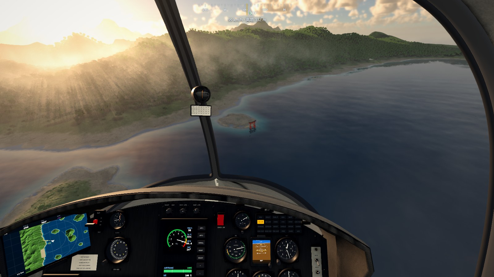
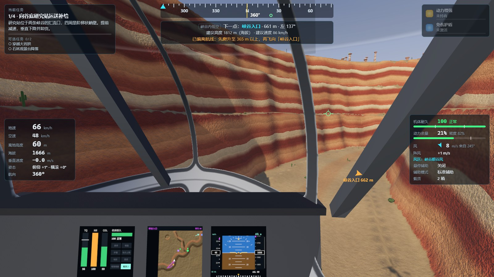
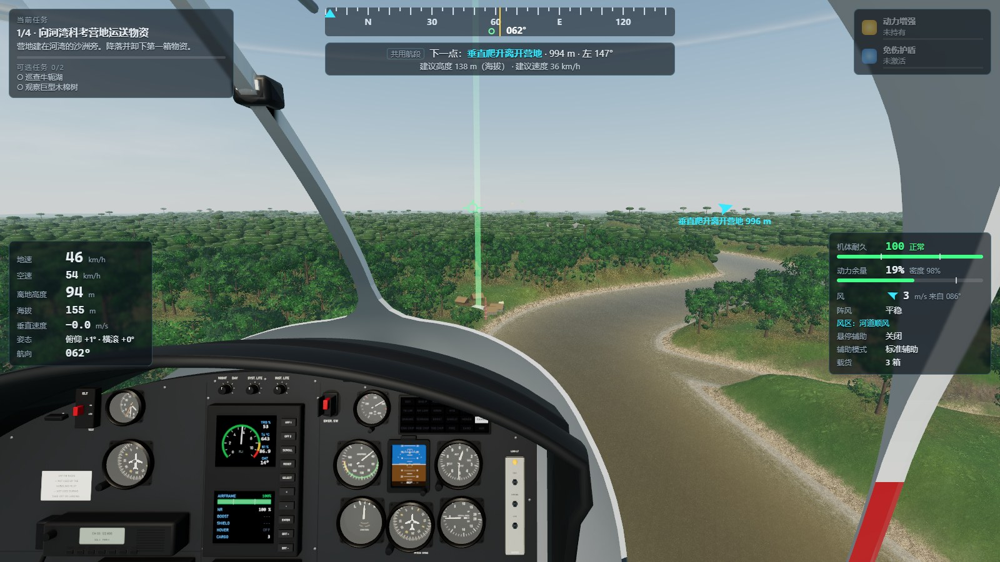
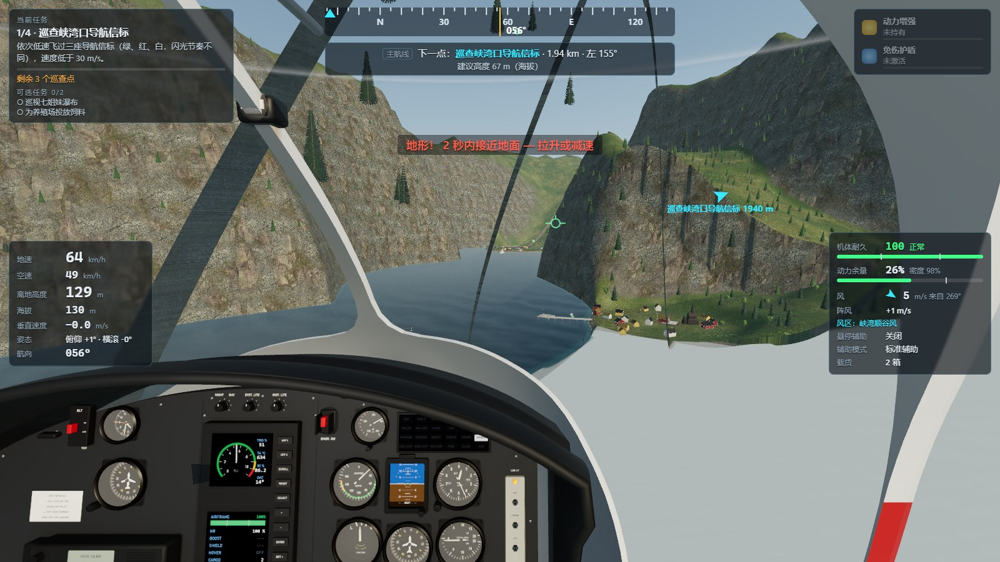
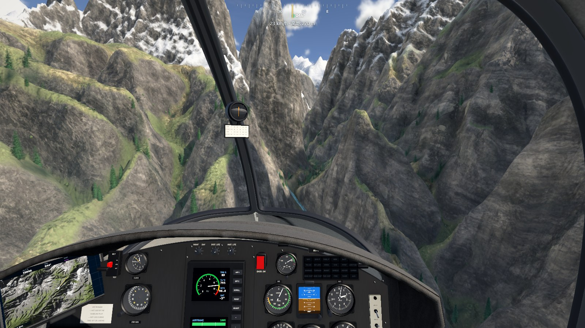
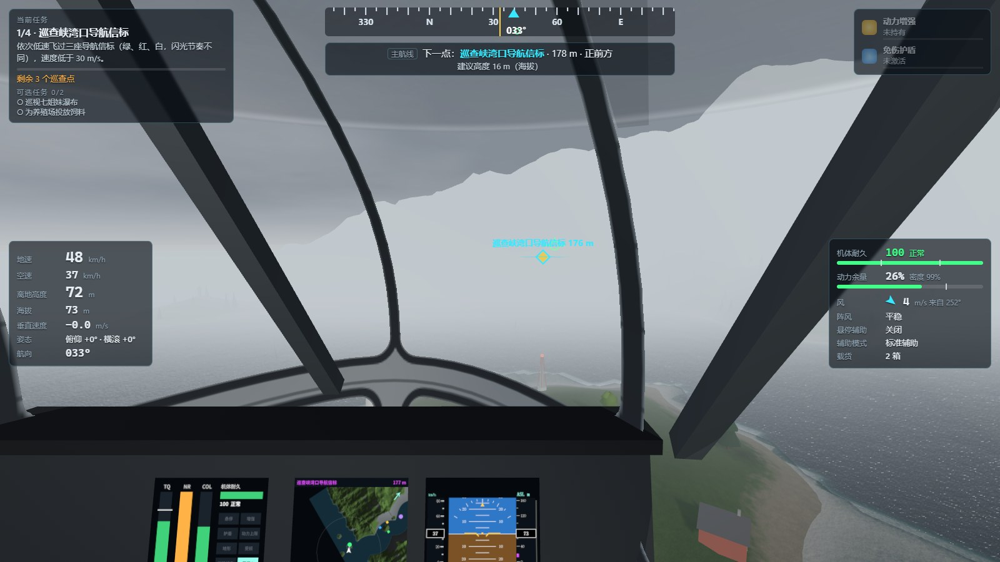
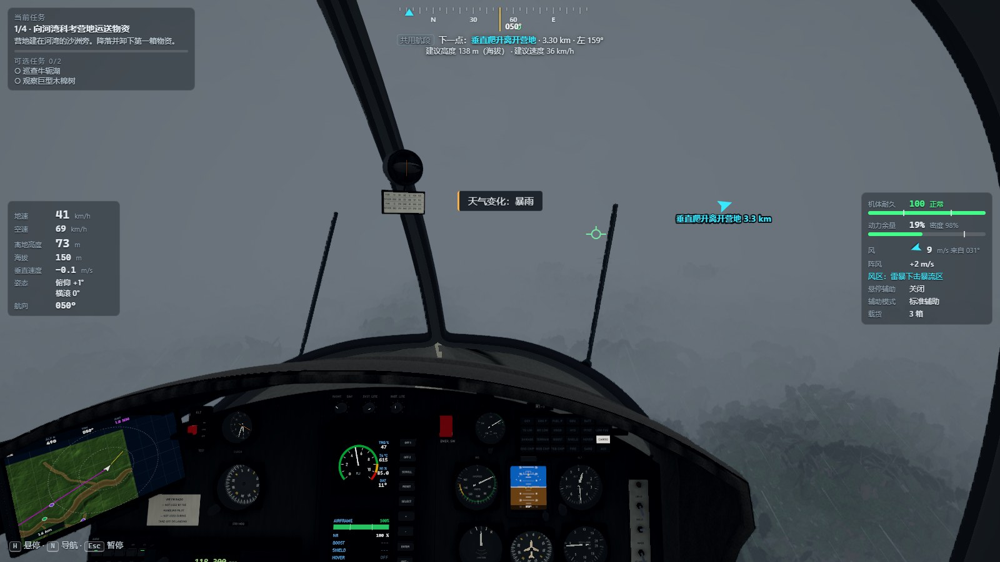
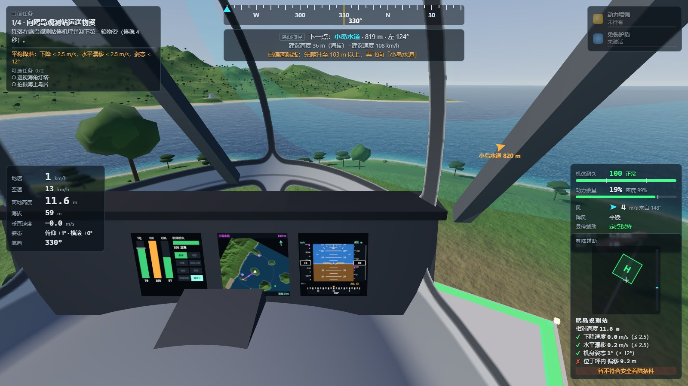
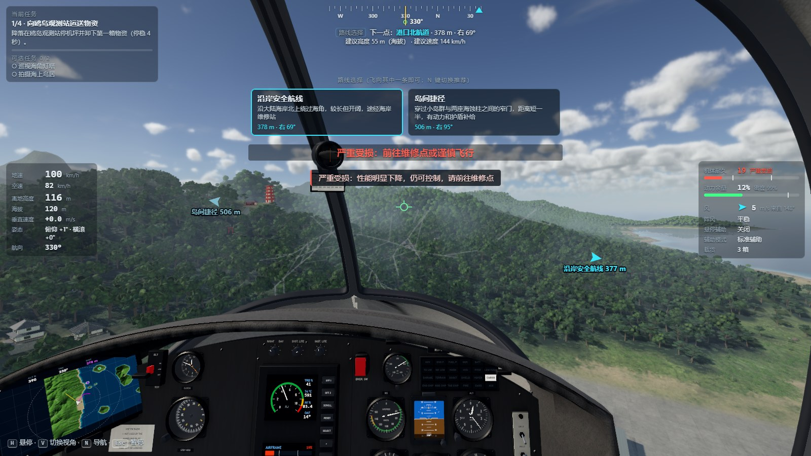
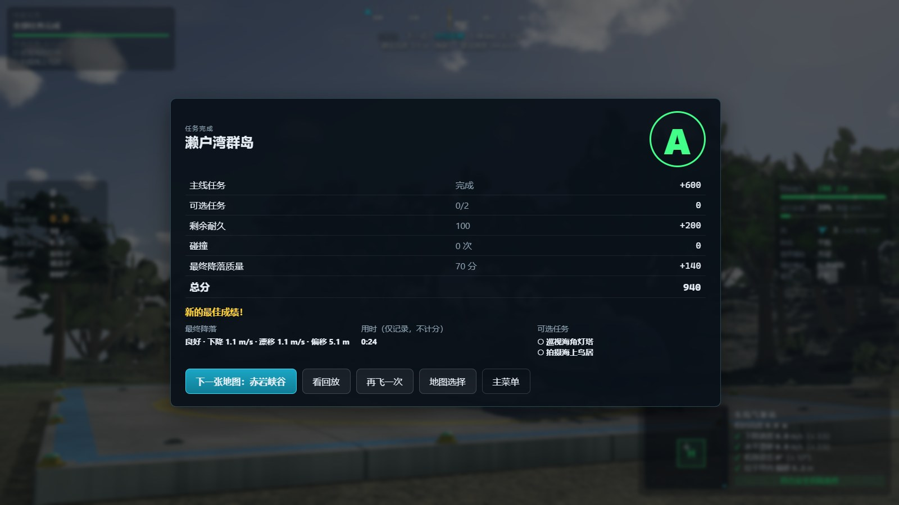

# Rotor Trails · 旋翼航迹

本地最新改进见 [2026-11-05 接手优化记录](docs/optimization-2026-11-05.md)：三轮代码审计、检查点与暂停修复、设置和渲染工作量优化、资源失败回收、Blender 停机坪细节及可重复验收工具。

第一人称拟真直升机闯关网页游戏。驾驶一架轻型直升机，在五张风格迥异的地图里执行运输、空投、巡查与精确降落任务：日本海湾群岛、美国西南峡谷、亚马孙雨林、挪威峡湾、喜马拉雅雪域。

**在线试玩：https://tenshojin.github.io/rotor-trails/** （需要键盘和鼠标，推荐桌面版 Chrome / Edge 并开启硬件加速）

- 纯前端静态网站：TypeScript + Vite + three.js（WebGPU 渲染器，不支持 WebGPU 的浏览器自动退回 WebGL2）+ Rapier 物理（WebAssembly），无后端、无在线 AI、无付费接口
- 驾驶舱、直升机外观、五张地图的建筑与 10 种树木都用本仓库里的 Blender 脚本建模（对照维基共享资源上的真实照片，照片只作参照、不随游戏分发）；地形与建筑使用 [Poly Haven](https://polyhaven.com) 的 CC0 照片材质；地形高度、天空、水面、仪表画面与音效为程序生成



| | | |
| --- | --- | --- |
|  |  |  |
|  |  |  |
|  |  |  |

更多截图见 [docs/screenshots](docs/screenshots)。

## 特色

- **从零开始的飞行训练**：7 课 26 步，从转头看四周开始，每步只教一个动作，只露出学到的按键和仪表；撞了回到这一课开头，不算失败。飞过的人可以在课程表里直接选课
- **休闲飞行**：没有任务、没有计时、没有失败。选好时段和天气直接在空中开始，飞行中随时换时段、换天气、跳到景点；按 J 让它沿景点自己飞，按 V 切到电影镜头，只管看风景
- **有惯性的飞行**：升力随机身倾斜而倾斜，加速、减速、转弯都需要时间和空间；空气密度随海拔下降，动力余量在 HUD 上实时显示
- **三档飞行辅助**（新手 / 标准 / 挑战）：辅助只帮你稳住飞机，不会抵消惯性和风；挑战模式下总距直接控制升力
- **风是真实的力**：持续风、可预测节奏的阵风、峡谷通道风、上升/下沉气流都通过相对气流作用在机身上；风向袋、旗帜、经幡、树木、雨线会显示风向
- **五种天气**：晴、雨、暴雨、浓雾、低云（另有晴转暴雨的动态天气）；在雾和云中，航点标记与 HUD 引导始终可见
- **耐久与降落判定**：70 / 30 两档性能下降（连续变化，始终可控）；降落看下降速度、水平漂移、姿态和位置四项
- **Buff**：动力增强（储存一次，Shift 使用）、免伤护盾（挡耐久损失但不挡碰撞）、维修补给
- **检查点**：可从最近检查点或更早的安全检查点恢复，也可“安全恢复”（稳定悬停状态继续），不会卡死
- **不计时的评分**：主线、可选任务、剩余耐久、碰撞次数、最终降落质量
- **能当壁纸的风景**：岩壁按地层一层层风化，水面映着山和树，峡谷和冰川谷里有河，山有长长的影子，转头时眼睛会慢慢适应明暗
- **写实画面**：对照 H125 实机照片建模的驾驶舱（指针式仪表、发动机/地图/姿态屏实时显示，软垫座椅、舱门内饰、后舱都能转头看）；物理天空 + 光线步进的体积积云（半分辨率时间累积，成团分布，云影投到地面、建筑与水面上，跟着云一起飘）与高空卷云；水力侵蚀的山体（沟壑、冲积扇）与岩石浮雕；随高度变淡的雾 + **体积雾与光束**（贴地薄雾与低空霾按阴影照亮：阳光穿过树林、屋檐、云缝形成丁达尔光束，远处雾里显出山影与云隙光，设置里可关）；出发前可选**时段**（白天 / 清晨 / 黄昏 / 夜晚：低角度的暖色阳光、长影、清晨的谷地晨雾；夜里是星空、水面上的月光、仪表背光、着陆灯和灯火）；雨天屋顶、地面、台阶被淋湿后变深变亮；座舱玻璃上的灰尘迎着太阳会泛起眩光；四级分层柔和阴影；照片材质地形（陡坡三平面投影、积雪按坡面朝向堆积、远处森林的树冠层）；带波浪、折射、岸边白沫和浑浊河水的水面；时间抗锯齿、环境光遮蔽、泛光、调色。画质分低 / 中 / 高 / 极高（Ultra）四档，首次启动按显卡自动选择（集成显卡默认低画质并提示）；另有**光线追踪**开关：进图时在地形里追踪真实光线，算出三次反弹的全局光照（背阴的岩壁被对面映成暖色、机腹接着地面反上来的光，画面外的山也算得到，没有噪点），金属映出地形，舱内光线随脚下的地面变化；飞行时每帧只多 1~2 ms，任意画质都可单独开关

## 快速开始

### 环境要求

- [Node.js](https://nodejs.org/) 20.x 中的 20.19.0 及以上版本，或 22.12.0 及更高版本；不支持 21.x（开发时使用 24.x）
- 桌面浏览器并开启硬件加速。推荐支持 WebGPU 的最新版 Chrome / Edge（Safari 26、Windows 上的 Firefox 也支持）；只支持 WebGL2 的浏览器同样能玩，画面效果相同、帧率略低

### 安装与运行

Windows 本地已安装依赖时，可直接双击 `Start-RotorTrails.cmd`。每次启动都会检查并构建当前源码，然后在固定地址 `http://127.0.0.1:4185/` 打开浏览器，避免误运行旧构建。游玩时保留启动窗口；关闭窗口或按 Ctrl+C 即可结束服务。重复启动时若端口已占用，请打开已运行的游戏，或先关闭旧启动窗口；不会自动换端口，以免浏览器把进度保存在另一地址下。

只检查环境并构建、不启动服务或打开浏览器，可运行 `Start-RotorTrails.cmd --check`；成功返回 0，失败返回非零状态。

```bash
npm install
```

```bash
npm run dev
```

然后在浏览器打开终端里显示的地址（默认 http://localhost:5173 ）。第一次进入建议先玩「飞行训练」。

### 常用命令

| 命令 | 作用 |
| --- | --- |
| `npm run dev` | 开发服务器（热更新） |
| `npm run typecheck` | TypeScript 类型检查 |
| `npm test` | 运行全部自动化测试（Vitest，约 15 秒） |
| `npm run build` | 类型检查 + 生产构建，输出到 `dist/` |
| `npm run preview` | 在 http://localhost:4173 预览生产构建 |
| `npm run mapviz` | 生成地图俯视图并检查所有航线净空（输出到 `tmp/maps/`） |
| `npm run regress` | 跨平台完整航线与天气验收（42 种情形，失败返回非零状态） |
| `npm run regress:recovery` | 六张地图 × 两种检查点恢复：坠毁后恢复并完成主线（12 种情形） |
| `npm run shots -- tools/steps/docs_shots.json docs/screenshots` | 用无头 Chrome 自动截图（需先 `npm run preview`） |

自动驾驶回归只通过飞行员输入驾驶，验证正式地图的航线和天气组合，以及坠毁后的任务恢复。以下入口支持 Windows、macOS 和 Linux，运行时间取决于机器性能：

```text
npm run regress
npm run regress:recovery
```

旧版 `tools/regress.sh` 仍可在 Git Bash 等环境中使用。

单独跑一张地图（bash 语法；PowerShell 中先执行 `$env:MAP="himalaya"; $env:PATHS="0,1"`）：

```bash
MAP=himalaya PATHS=0,1 npx vitest run --config vitest.tools.config.ts tools/autorun.tool.ts --silent=false
```

## 操作

| 按键 | 操作 |
| --- | --- |
| W / S | 机体前倾加速 / 后倾减速（低速时缓慢后退） |
| A / D | 左 / 右转（自动协调机头与坡度） |
| 空格 | 爬升（增加升力） |
| C | 下降（减小升力）。默认键位不用 Ctrl：浏览器不允许网页拦截 Ctrl+W，按住 W 时再按 Ctrl 会关闭页面 |
| Q / E | 向左 / 右平移（悬停修正、侧风修正） |
| H | 悬停辅助：逐渐减速并保持位置 |
| Shift | 使用已储存的动力增强 |
| 鼠标 | 观察四周（不控制飞机方向）；点击画面锁定鼠标，浏览器不允许锁定时按住左键拖动 |
| Z / V | 视角回正 / 座舱与追尾视角切换 |
| N / M | 切换导航目标或推荐路线 / 座舱地图范围 |
| U | HUD（自动 / 完整 / 隐藏；自动：平稳飞行时面板收起，只留航向带和下一个航点） |
| Esc 或 P | 暂停 |

所有按键都可以在「设置 → 操作」中改键；设置、通关记录保存在浏览器本地存储里（存档损坏或存储不可用时自动回退为默认值）。

## 地图

| 地图 | 难度 | 主线任务 | 路线选择 | 天气 |
| --- | --- | --- | --- | --- |
| 飞行训练场 | ★ | 8 步教学（起飞、加速、减速、转向、高度、悬停、侧风修正、降落），可跳过、可重复 | — | 晴朗、有风 |
| 濑户湾群岛（日本） | ★ | 鸥岛观测站 → 海上平台空投 → 中岛山脊观测站 → 东岛气象站 | 沿岸安全航线 / 岛间捷径（海蚀柱窄门）；越岭直飞 / 绕岛东岸 | 晴、小雨、海风 |
| 赤岩峡谷（美国西南） | ★★★ | 谷底研究站 → 巡查传感器 → 峭壁岩架悬停投放 → 天空台地 | 峡谷内低空 / 高处绕行；穿越岩拱峡 / 东缘高空绕行 | 晴、局部阵风、山谷大风 |
| 雨林河湾（亚马孙） | ★★★ | 河湾营地 → 林间空地 → 科考船悬停投放 → 林冠观测平台 | 沿主河道 / 林冠直飞；狭窄支流 / 林冠绕行 | 晴、小雨、暴雨、晴转暴雨 |
| 雾湾峡湾（挪威） | ★★★★ | 巡查导航信标 → 悬崖农场 → 村落码头 → 峡湾港口 | 宽阔主航道 / 近岸海峡；沿峡湾水道 / 翻越山口 | 晴、浓雾、侧风 |
| 雪域山口（尼泊尔） | ★★★★★ | 山脊寺院 → 冰川营地空投 → 山口研究站 → 约 5140 m 的冰斗平台 | 沿冰川谷 / 刀脊直上；冰川谷道 / 高空越脊 | 晴、低云、强风 |

每张正式地图都有 2 个可选任务、维修/备降点、多处检查点和地标。自动驾驶完成主线的仿真时间为 5–12 分钟；真人玩家的用时会更长，但**尚未经过真人试玩测量**（见 [测试报告](docs/test-report.md)）。

## 美术素材（重新生成）

模型与贴图已经生成好并提交在 `public/` 下，平时不需要重新生成。修改建模脚本后的重新生成步骤（需要 Blender 4.x / 5.x，以及装有 Pillow、NumPy、SciPy 的 Python 3）：

1. `node tools/fetch_assets.mjs`：按 [tools/assets/sources.json](tools/assets/sources.json) 下载 Poly Haven 材质与参照照片到 `art/src/`（不进仓库）
2. `python tools/prep_textures.py <材质id>:1024 …`、`python tools/prep_terrain.py`、`python tools/prep_detail.py`：缩放、转换贴图
3. `python tools/blender/tex_variants.py`、`python tools/blender/jtex.py`、`python tools/blender/leaf_atlas.py art/out/trees`、`python tools/blender/cockpit_textures.py art/out/cockpit_tex`：颜色变体、木瓦、日式瓦格子 / 花岗岩、叶片图集、仪表盘面
4. `blender -b --factory-startup --python tools/blender/<脚本>.py -- public/models/<文件>.glb [--preview 预览目录]`：脚本有 `cockpit.py`（另需贴图目录与 `--bake`）、`heli_ext.py`、`trees.py`、`props_japan.py`、`props_fjord.py`、`props_himalaya.py`、`props_amazon.py`、`props_canyon.py`，用法写在各脚本开头
   座舱还要烘焙环境光遮蔽：`blender ... tools/blender/cockpit.py -- public/models/cockpit.glb art/out/cockpit_tex --bake`，然后运行 `tools/blender/ao_finish.py` 生成 `public/models/cockpit_ao.jpg`。

模型文件缺失或加载失败时，游戏会退回程序生成的几何体，仍然可以玩。

停机坪灯具与固定环可单独生成：`blender -b --factory-startup --python tools/blender/pad_fixtures.py -- public/models/pad_fixtures.glb --preview tmp/pad-fixtures`。游戏按材质批量绘制这些部件，灯光位置跟随停机坪朝向。

## 部署到 GitHub Pages

本仓库已开启 GitHub Pages：每次推送到 `main`，工作流通过检查后自动部署到 https://tenshojin.github.io/rotor-trails/ 。

仓库里的 [.github/workflows/deploy.yml](.github/workflows/deploy.yml) 在每次推送到 `main` 时自动执行类型检查、测试和构建；构建产物使用相对路径（`base: './'`），可以放在任何子路径下（例如 `https://<用户名>.github.io/rotor-trails/`）。

在自己的仓库（例如复刻后）开启发布的步骤：

1. 仓库 **Settings → Pages → Build and deployment → Source** 选择 **GitHub Actions**
2. 仓库 **Settings → Secrets and variables → Actions → Variables** 新建变量 `DEPLOY_PAGES`，值为 `true`（或在 Actions 页面手动运行一次 “CI / Pages” 工作流）
3. 等待工作流完成，在 Pages 设置页查看网址

> 注意：**私有仓库**使用 GitHub Pages 需要付费方案（GitHub Pro / Team / Enterprise）。免费账号需要把仓库改为公开才能启用 Pages——是否公开由仓库所有者决定。

也可以把 `npm run build` 生成的 `dist/` 目录上传到任意静态网站托管服务；不能直接双击打开 `dist/index.html`（浏览器不允许从本地文件加载模块）。

## 目录结构

```
src/
  core/        数学、噪声、固定步长推进器
  config/      飞行参数与三档辅助（集中配置）
  sim/         仿真：飞行模型、物理（Rapier）、起落架、风、天气、损伤、Buff、任务、导航、评分、自动驾驶
  maps/        五张地图 + 训练场（数据驱动：地形函数、站点、航点、航段、任务、天气、风区）
  world/       世界生成：高度场、建筑与道具、植被
  render/      渲染：地形、水、天空、树、建筑、座舱、仪表、导航标记、天气特效
  game/        应用状态机、输入、设置、存档、教学
  ui/          HUD、菜单与样式
  audio/       程序化音效（旋翼、发动机、风、雨、告警）
tests/         自动化测试（Vitest）
public/
  models/      Blender 导出的模型（驾驶舱、直升机外观、各地图建筑、树木）
  textures/    地形照片材质、建筑细节贴图
tools/         地图俯视图、航线净空、自动驾驶回归、截图等开发工具
  blender/     Blender 建模脚本（驾驶舱、直升机、建筑、树木）与贴图生成脚本
  assets/      美术素材来源清单（Poly Haven 材质、参照照片及其作者与许可）
docs/          设计文档、进度、测试报告、截图
```

## 文档

- [docs/design.md](docs/design.md)：设计与技术方案
- [docs/progress.md](docs/progress.md)：开发进度与已知问题
- [docs/test-report.md](docs/test-report.md)：测试报告（区分自动化测试、自动驾驶验证与尚未进行的真人试玩）
- [THIRD_PARTY_LICENSES.md](THIRD_PARTY_LICENSES.md)：第三方开源库许可

## 许可

本项目代码尚未指定开源许可证（默认保留所有权利）。所用第三方库、Poly Haven 材质（CC0）与参照照片的说明见 [THIRD_PARTY_LICENSES.md](THIRD_PARTY_LICENSES.md)。
