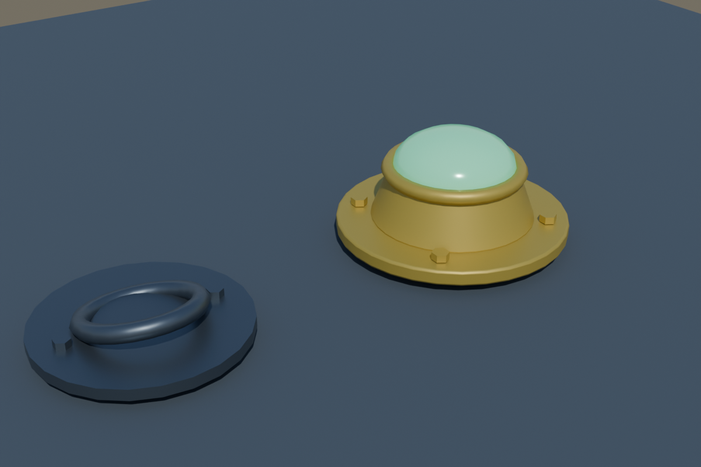

# 2026-11-05 接手优化记录

本轮在现有 Rotor Trails 项目上迭代，保留六张场景、任务、飞行参数和既有 Blender 模型。主要目标是修复实际运行缺陷、完善操作体验、减少无效渲染工作，并补充起降场景细节。

## 运行与恢复

- 修复恢复较早检查点后保留未来碰撞时间、在空中持续扣耐久的问题。
- 恢复时清除旧按键、待触发操纵、维修进度、接触和告警状态；立即刷新风况。
- 浏览器失焦自动暂停；暂停期间失败和结算倒计时冻结。
- 关卡加载防重复触发，失败后可以返回菜单重试；预热异常也会恢复渲染器状态。
- 存储写满时仍能读取已有进度；损坏存档备份失败时保留原数据。
- 切地图停止旧环境声源，短音效结束后释放节点。
- 教程和 HUD 的操作提示跟随实际改键。

## 界面

- 地图、天气、时段、辅助选择可由键盘操作，显示清晰的焦点和选择状态。
- 弹窗隔离背景焦点，Tab 在弹窗中循环；Escape 关闭并返回触发按钮。
- 改键可取消，冲突时保留原绑定并说明冲突动作，关闭设置不会留下捕获回调。
- 改善窄窗口、低高度窗口、任务面板、中央导航和着陆辅助的布局。
- 重要告警保持可见；减少相同内容的 DOM 重建，航向 360° 显示为 000°。
- 高分辨率屏幕的航向带、着陆示意图采用匹配的画布分辨率。
- 修正关于页对照片材质与第三方素材的说明。

## 画面与资源

- Blender 新建低矮停机坪灯具和固定环：原始几何，无额外外部素材；压缩 GLB 11,816 字节，三种材质。
- 所有停机坪增加地面接缝；高架风向袋增加支架。装饰不改变原停机坪碰撞体。
- 灯具全场景使用三个实例批次；实体灯、夜间光点和任务闪灯共用旋转坐标，四角不再重复。
- 任务烟幕放在甲板内，避免悬在高架平台之外。
- 下洗尘土、水雾、雪沫由最多 72 个独立精灵合并为一个透明实例批次；按距离排序。修复粒子越过寿命时的 NaN 透明度。
- 同一地图切换昼夜时同步太阳山影、着陆灯、曝光上限与云的历史画面。
- 释放后期管线及中间纹理，关闭已解码的模型图片；失败或过期的预取资源也会回收。
- 贴图加载失败后可重试；上一张地图的异步曝光结果不能污染新地图。
- 关闭自动曝光时停止 GPU 读回；动态模糊减少一次冗余全屏复制。
- 从低画质切换到中/高/极高时补载照片地形材质；保留原几何和碰撞，快速切回或换图时回收过期结果。
- 修复日本塔楼三个细节级别的墙面缺失贴图坐标；仅补充 UV 数据，保留原压缩几何、图片与其他模型。建模脚本同步修正，并检查全部九个 GLB 的材质与 UV 对应关系。
- 补齐地图卸载时风向袋、旗面、信标材质与岩层纹理的释放，确保全局共享素材不被误释放。

新灯具的 Blender 预览（美术模型预览，不是游戏截图）：



## 本地启动

双击根目录的 `Start-RotorTrails.cmd`。每次启动均检查并构建当前源码，固定使用 `http://127.0.0.1:4185/`，避免静默改端口造成浏览器进度看起来丢失。已有游戏占用该端口时会给出说明。`Start-RotorTrails.cmd --check` 只检查和构建，不打开浏览器。

## 可重复验证

```text
npm test
npm run typecheck
npm run build
npm run regress
npm run regress:recovery
```

`npm run regress` 是跨平台验收入口，覆盖五张正式地图四种路线组合与十一种恶劣天气的两种路线组合，共 42 种情形。任务未完成、坠毁、碰撞或耐久损失都会使命令失败；逐项结果保存在 `tmp/acceptance/`。旧版 `tools/regress.sh` 保留供参考。

`npm run regress:recovery` 覆盖六张地图的两种检查点恢复方式，共 12 种情形：实际起飞后保存空中检查点，触发坠毁，再恢复并继续完成主线。逐项结果保存在 `tmp/recovery-acceptance/`，与正常航线验收一起纳入 CI。

启动开发服务器后，还可打开：

- `/tools/ui-regression.html`：真实浏览器 DOM、焦点和键盘交互回归，不启动地图或 GPU。
- `/tools/render-review.html`：手动/自动场景巡检、机位切换、昼夜、画质、光追、PNG 和 JSON 导出。使用独立内存存档，静音、不锁鼠标，不读写玩家进度。

## 第一轮验证范围与待办

- 最终完整回归 152/152 项通过；随后新增的验收工具边界回归 7/7 项通过，合计 25 个文件、159 项通过。类型检查、生产构建、Windows 启动器 `--check` 和差异空白检查通过。结构化记录见 [verification-2026-11-05.json](verification-2026-11-05.json)。
- 42/42 组航线与天气自动驾驶验收通过：主线完成、未坠毁、零碰撞、耐久均为 100。精简结果见 [acceptance-2026-11-05.json](acceptance-2026-11-05.json)，详细过程位于 `tmp/acceptance/`。
- 浏览器界面回归在 1280×720 与 640×600 两种窗口中均通过 11/11 项。
- 已在 WebGPU 观察到完整座舱、机身和新停机坪模型，训练场资源完整性与持续渲染检查通过。日本场景的三条 UV 警告据此定位并修复。
- 最终六图、连续昼夜/画质/光追切换、WebGL2 与截图导出的浏览器复验**尚未完成**：恢复测试连接时，浏览器明确拒绝本地页面访问授权，因此停止了浏览器操作。之前素材路径不正确、使用回退几何的巡检，以及中途停止的巡检，均不计为通过。
- 最终 UV 修复与资源释放已通过静态和针对性回归，但尚未完成浏览器画面复验。不报告前后 FPS 增幅，也不据此声称跨设备稳定或“零缺陷”。
- PNG 导出在浏览器工具等待下载时曾超时；已改为页面预览与持久下载链接，增加 15 秒超时、场景冻结和错误恢复，并通过非浏览器边界回归。修改后的实际浏览器导出仍待复验。

自动驾驶验证路线可完成性，浏览器巡检验证加载与渲染；二者都不能替代真人完整试玩。修改保留在本地工作区，未提交、推送或发布线上版本。

## 第二轮：代码审计与优化

本轮按主循环与生命周期、仿真与世界生成、渲染资源、输入/存档/音频/界面四个方向审查。保留既有美术和飞行参数；以能够复现的错误、资源所有权和高频调用为优先，不为缩短代码而整体重写架构。

### 主循环、加载与停止

- 新增完整的 `App.dispose()`：停止动画帧、移除全局监听、取消改键和鼠标锁定、释放物理/音频/界面。尚在生成的地图或物理世界结束后会被清理，不能复活已停止的游戏。
- 重复 `start()` 共用同一初始化过程；启动失败和开发环境重新初始化时清理旧实例。
- 帧内异常停止后续仿真与绘制，并显示恢复提示，避免每帧继续报错或后台仍在飞行。
- 着色器预热无进展、编译和 GPU 等待有明确超时与取消路径；恢复临时编译钩子。后台标签页暂停动画不计为无进展。
- 帧率按真实时间计算；物理推进仍保留原来的长帧上限，卡顿不会再被统计上限掩盖。
- 设置即时生效，连续拖动期间合并写存储；关闭设置、页面隐藏或退出前保存最终值。测试中连续 21 次变化只产生一次常规保存。
- 复用菜单相机向量、仪表航线点、任务点和补给点；改道、完成、领取与检查点恢复仍立即反映。

### 仿真与地图

- 世界生成只修改本次运行的航点/补给副本，不再污染共享地图定义；俯视图工具使用生成后的坐标。
- 清理动态树木碰撞体时不再残留失效 wrapper；检查 100 次创建/移除后无残留。
- 树冠排除查询覆盖邻近空间格，并剔除地图外树木。保留原随机数消费顺序，只删除不合法候选，避免移动其他植被影响航线。
- 查询任务目标改为只读，不会因为 HUD、仪表或调试查询而推进巡查任务。
- 检查点恢复重置锁定着陆点的提示计时；零宽度平滑边界不会产生 NaN。
- 导航的静态路线序列、分岔共用前缀和独有航点仅计算一次；近距离直飞不再计算不会使用的地形安全高度。

### 渲染资源与热路径

- 外观与座舱的晚到模型/遮蔽贴图在销毁后被回收；加载部分失败也释放已经成功的资源。
- 模型材质、贴图和解码图片按所有权去重清理；导航对象不再误释放其他 Sprite 共用的几何。
- 修复真实外观加载后，程序桨叶被每帧重新显示，造成两套桨叶叠加的问题。
- 相机、座舱操纵和导航动画复用临时向量；平面透明特效避免无贡献的第二次提交。
- 修改视场角时先更新相机，再重新计算阴影范围；云影/体积雾绘制失败时恢复渲染目标与清屏状态。
- 岩石浮雕加载失败可重试，解码失败关闭图片；替换共享纹理时保留对象引用并回收旧分配。
- 检查 Three 实际的着色器错误标记，避免编译 Promise 正常结束却将失败当作成功；处理渲染器异步销毁失败，防止产生未处理的拒绝。

### 输入、存档、音频与界面

- 无效按键与输入法组合状态不能覆盖原绑定，失焦取消待捕获改键。
- 鼠标锁定按请求代次处理：旧失败不能污染新成功，销毁后晚到的锁定会退出。
- 有效 JSON 但结构错误的存档先备份；来自较新版本的存档只读，避免旧客户端降级覆盖未知数据。
- 教程要求“连续保持”的动作被打断后重新计时；不变的提示内容不重复生成。
- 暂停只淡出发动机与环境声，菜单/结算提示仍可播放；静态 300 帧不重复追加音量参数事件；初始化部分失败也关闭上下文。
- 界面和 HUD 可幂等销毁；清除提示计时器、画布和焦点引用，退出时不触发保存或恢复飞行的旧回调；隐藏 HUD 不再读取飞行状态。

### 工程入口

- 包元数据声明与 Vite 相符的 Node 范围。
- CI 增加 42 组全路线/天气验收，失败将阻止后续发布步骤；本轮未推送或触发线上工作流。
- Artifact 导出清单覆盖全部构建依赖，包括 WASM，避免只列 JavaScript 而漏掉解码依赖。

本轮仅做代码和离线行为验证，没有操作浏览器。第一轮的浏览器观察不能视为第二轮修改后的完整画面验收；性能改进不等于已经测得 FPS 增幅。

### 第二轮验收结果

- **217/217 项测试通过，36 个测试文件**；比第一轮增加 58 项。最终完整运行耗时 50.58 秒。
- **42/42 组完整路线与天气回归通过**，耗时 200.61 秒；全部主线完成、未坠毁、零碰撞、耐久 100。
- TypeScript、生产构建、Windows 启动器 `--check`、差异空白检查通过。
- Artifact 导出验证 61 个文件，覆盖全部 10 个构建依赖、两个 WASM 文件和九个模型；模型转换前后字节一致。
- 对 App 生命周期、编译取消及地图副本调用方式进行了交叉审阅，发现的后台预热超时误判已修复并回归。

结构化结果见 [code-audit-2026-11-05.json](code-audit-2026-11-05.json)。当前代码与构建均保留在本地；没有推送或发布。

## 第三轮：故障路径、设置语义与交叉审计

本轮继续审查已通过测试的代码，重点检查初始化中途失败、异步请求乱序、检查点恢复与界面反馈是否一致。每个方向完成后由另一位审阅者沿真实调用路径复核。

### 启动与资源释放

- `App` 构造中途失败时，逆序回收已经创建的渲染、HUD、输入与界面对象，移除画布及全局监听。故障注入覆盖创建到一半和监听全部注册后的失败；原实现均可复现泄漏。
- `GameSession` 构造失败会释放已分配的物理世界与事件队列；地形、障碍物、直升机创建、状态读取四阶段均有真实 WASM 分配的故障测试。
- 物理世界配置失败会回收已有分配；重复销毁不再重复释放，销毁后的迟到仿真步、恢复或传送不访问失效资源。
- 物理引擎首次初始化失败不再永久缓存失败 Promise，后续尝试可以重新初始化。

### 设置与画面工作量

- 音量、按键、HUD 和默认辅助变化不再重置画布、重配阴影、重建后期或触发环境光烘焙。计数测试连续修改 20 次，这些操作均维持初始化时各一次。
- 只按实际变化更新渲染配置，兼容原地修改同一个设置对象；新地图完成构建后显式同步当前配置。
- 尺寸和像素密度变化合并为一次画布更新；相同尺寸直接跳过，视场角单独更新投影和阴影范围。
- 地形区分当前材质与请求中的材质，取消升级不会重建原材质；旧请求迟到或失败不能覆盖新的选择。
- 后期替换构建失败时保留原管线，并允许重试；普通和反向深度分别缓存，避免混用纹理格式。
- “显示操作提示”真正控制起飞页和普通飞行提示，显示实际绑定的按键。教学步骤、安全告警保留；Enter 被重新绑定后，教学改为提示通过暂停菜单跳步。
- 明确动态模糊的画质条件，以及速度选项只控制 HUD。默认辅助仍作为新任务的默认值，不悄悄改变本次飞行。

### 飞行反馈与检查点

- 修复桥/拱下方的空中检查点被“安全恢复”抬进上方结构的问题。恢复位置计入结构和树冠顶部，保留原有 25 米余量；针对性实跑恢复后两秒保持零碰撞与完整耐久。
- 着陆快照深拷贝可变记录，运行时修改不会污染已保存的检查点；无效着陆数值不再判为安全。
- HUD 的停机坪边缘判断与实际评分使用同一边界，162 组边界组合结果一致。
- 修复风向跨整圈插值、无效天气时长/能见度/阵风周期，以及弱天气下阵风提示偏大、禁用风区仍预警的问题。修复后提示与实际风场使用同一有效权重。
- Enter/空格作为暂停键时，恢复飞行只消费一次按键，避免同时激活菜单按钮或跳过教学；训练与重复拾取提示不再写死可重绑定的按键。

本轮没有浏览器操作；画面复验仍沿用上文的待办。当前没有同页并发创建多个渲染实例的正常入口，开发入口未接受模块热替换并会整页重载；共享渲染状态的多实例隔离属于未来功能边界，本轮没有为此重写架构。

### 第三轮验收结果

- **266/266 项测试通过，41 个文件**，比第二轮增加 49 项；完整测试运行约 59 秒。
- **42/42 组正常航线与天气验收通过**，主线全部完成、未坠毁、零碰撞、耐久 100，运行约 238 秒。
- **12/12 组六张地图的坠毁恢复验收通过**：精确恢复与安全恢复均能继续完成主线，恢复后零碰撞、耐久 100，运行约 85 秒。此项已加入 CI。
- TypeScript、生产构建、Windows 启动器 `--check`、差异空白检查、依赖锁文件一致性检查通过。
- 最终 Artifact 清单 61 个文件，包含全部 10 个构建依赖、两个 WASM 和九个模型；无缺件，模型转换前后字节一致。
- npm 漏洞公告接口检查了锁文件中的 91 个依赖包，检查时未报告受影响版本；这不代表不存在尚未公开的漏洞。
- 各组验收并行运行，耗时只作为验证记录，不用于宣称性能提升。没有测量 GPU 帧率增幅，没有推送或发布。

逐项航线与恢复结果见 [acceptance-round3-2026-11-05.json](acceptance-round3-2026-11-05.json)，测试文件清单、依赖检查、构建哈希与范围限制见 [code-audit-round3-2026-11-05.json](code-audit-round3-2026-11-05.json)。本轮已定位的问题均已修复并通过回归；最终画面复验仍未完成，不将这些结果表述为绝对零缺陷。

## 后续

这三轮修改已合入 `main` 并发布。上文提到的浏览器复验（六张图、画质切换、WebGL2）已在之后补做，结果见 `docs/test-report.md`。